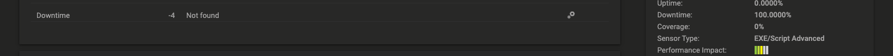

# PRTG Morning Check

A PRTG sensor that posts the day's list of Unknown, Down and acknowledged
sensors each morning through the notification PRTG already sends, and
posts "ALL CLEAR" when the list is empty. Runs on any probe with one
read-only API key, which PRTG itself holds; nothing else to install.

> **The sensor is red while it is unpaused each day.** Its Down state is
> what carries the report. Give it its own group so the red stays out of
> the rest of the tree, and pass `-SelfSensorId %sensorid` so it does not
> list itself.

## Run it

Against the synthetic fixtures, from a Windows PowerShell prompt in the repo
folder (no PRTG needed):

```powershell
powershell -ExecutionPolicy Bypass -File tests\Invoke-Fixture.ps1
powershell -ExecutionPolicy Bypass -File sensor\Get-MorningCheck.ps1 -FixtureFile fixtures\sensors-findings.json -SelfSensorId 9001
```

On a probe, the sensor's Parameters field:

```
-Server https://<core> -Token '%windowspassword' -SelfSensorId %sensorid -ExcludeGroups 'Lab'
```

## What you get

- **A post every morning**, with or without findings, sent by the
  notification template you already use for email, chat or an on-call
  platform. A clean morning reads
  `ALL CLEAR: 0 unknown, 0 down, 0 acknowledged, 0 partial`. PRTG allows a
  sensor message one line long and up to 2000 characters (escaped), so the list uses
  ` | ` between entries and a long one ends in `+N more`. The cut starts
  from the acknowledged end, so the Down entries go in first.
- **Proof the check ran.** A schedule keeps the sensor paused outside a
  short daily window. Inside the window the sensor goes Down, a device
  trigger sends the post, and at the end of the window the schedule pauses
  it again.
- **A dead-man switch, if you want one.** A second trigger pings a
  heartbeat URL, so you get an alert on the morning the post does not
  arrive.

Four standard PRTG features do one job each: the sensor state carries the
report, the schedule sets the daily window, a state trigger turns the
resume into the post, and a notification template delivers it.
[docs/HOW-IT-WORKS.md](docs/HOW-IT-WORKS.md) shows each one.

## Deploy

1. **Make the API key.** The sensor reads PRTG with its own read-only
   user. In PRTG:

   1. Setup > User Accounts > Add User Account. Name it `morning-check`,
      put it in a read-only user group, no acknowledge rights, no
      password change.
   2. Log in as that user, then Setup > Account Settings > API Keys >
      Add API Key, read access. PRTG shows the key once; copy it. Step 3
      asks for it and stores it on the Morning Check device, where the
      sensor reads it as `%windowspassword`.

2. **Install on the probe.** In an elevated PowerShell on the probe host:

   ```powershell
   irm https://raw.githubusercontent.com/CC-Digital-Innovation/prtg-morning-check/v1.0.2/deploy/Install-MorningCheck.ps1 | iex
   ```

   It downloads the sensor from the `v1.0.2` tag, checks its SHA-256
   against the hash written into the installer, and only then puts it into
   `Custom Sensors\EXEXML`. No restart; the probe reads the script on every
   scan. Re-run it to upgrade. From a checkout,
   `.\deploy\Install-MorningCheck.ps1` copies the local file instead,
   unchecked, since that copy is the one you have read.

3. **Create the PRTG objects.** From any machine that reaches the core:

   ```powershell
   irm https://raw.githubusercontent.com/CC-Digital-Innovation/prtg-morning-check/v1.0.2/deploy/Deploy-MorningCheck.ps1 | iex
   ```

   It asks for the core URL, an admin login and the sensor's API key, then
   reads the server and lets you pick the probe and the notification
   templates from numbered lists. Enter accepts the default shown in
   brackets. It shows the plan, offers to save your answers to
   `settings.json` (the key is left out), and asks before creating
   anything. A run looks like this:

   ```
   PRTG core URL [https://prtg.example.com]: https://prtg.corp.example
   Admin login name: prtgadmin
   Passhash (PRTG > Setup > Account Settings > My Account): ********
   Probes on this server:
       1. Local Probe  (id 1)
       2. Warehouse probe  (id 2211)
   Probe that runs the sensor (number or name) [Local Probe]: 2
   Address the sensor uses to reach the core [https://prtg.corp.example]:
   API key of the sensor's read-only user (blank keeps the one on the device): ********
   Window start (HH:mm) [06:00]:
   Window end (HH:mm) [06:10]:
   Days (e.g. Mon Tue, weekdays, every day) [Mon Tue Wed Thu Fri Sat]: weekdays
   Group name substrings to leave out, comma-separated (blank for none): Lab
   Notification templates on this server:
       1. Email to on-call  (id 300)
       2. Chat channel  (id 301)
       0. none
   Template that sends the daily post (0 = none yet): 1
   ...
   Create these objects now? (y/n) [y]:
   ```

4. **Next time**, or on the next server, reuse the saved answers from a
   checkout:

   ```powershell
   .\deploy\Deploy-MorningCheck.ps1 -SettingsFile .\settings.json -WhatIf   # shows what it would create
   .\deploy\Deploy-MorningCheck.ps1 -SettingsFile .\settings.json
   ```

   `deploy\settings.example.json` shows the fields. Any of them can also be
   a parameter, which wins over the file: `-WindowStart 07:30 -Days weekdays`.
   The API key is not in the file: pass `-ApiKey` the first time on a
   server, and again only to replace it. A replaced key takes effect when
   the schedule next resumes the sensor.

The script creates the schedule, the group under the probe, the device, the
sensor with the schedule attached, and a Down trigger for each notification
you named. It looks each object up by name and creates only what is
missing. It re-applies the sensor's parameters, schedule and interval on
each run, so re-run it to change an exclusion, move the window or add a
trigger. You make the heartbeat notification template by hand;
[docs/PRTG-SETUP.md](docs/PRTG-SETUP.md) step 5 has the fields.

Three settings the script makes for you matter if you build the objects by
hand. The sensor gets `-SelfSensorId %sensorid`, or it lists itself. The
device has trigger inheritance off and its own trigger with zero latency,
because a Root trigger with a latency longer than the window never fires
for a sensor that is Down for ten minutes a day.

## When it runs

The schedule keeps the sensor paused outside the window. At `windowStart`
the sensor resumes and goes Down with the report, the trigger sends the
post, and at `windowEnd` the schedule pauses it until the next listed day. PRTG applies the
schedule about a minute after each boundary and runs the first scan about
three minutes after the resume, so a 06:00 window posts at 06:04. Keep the
window ten minutes long: with a five-minute interval that leaves a second
scan if the first one hits a transient error, and a shorter window can
close before the first scan.

Read [docs/HOW-IT-WORKS.md](docs/HOW-IT-WORKS.md) for the chain from schedule
to notification, and [docs/PRTG-SETUP.md](docs/PRTG-SETUP.md) for what each
object is, the schedule's pause lines, and the API call behind each step.

## Example output

The sensor message, which the notification carries as its body. Both come
from the synthetic fixtures in `fixtures/`, so the names are made up.

```
5 to check: 1 unknown, 1 down, 2 acknowledged, 1 partial | DOWN: Local Probe > [ACME] Store 12 > Store 12 Router > Ping | UNKNOWN: Local Probe > [NORTHWIND] HQ > Backup & Archive NAS > SNMP Disk Free | PARTIAL: Local Probe > [NORTHWIND] HQ > Core Switch A > SSL Certificate (Port 443) | ACK: Local Probe > [ACME] Store 12 > Store 12 Router > Primary Interface | ACK: Remote Probe North > [ACME] Warehouse > Dock Camera 3 > Ping
```

```
ALL CLEAR: 0 unknown, 0 down, 0 acknowledged, 0 partial
```

The sensor writes its result as plain ASCII. Windows PowerShell 5.1 outputs in the console
code page while PRTG reads UTF-8, so a single `®` or accented letter in any listed sensor's
name used to fail the whole run with PE231 "Structural error in xml file". Non-ASCII
characters now go out as numeric references (`&#174;`) and PRTG shows the original character;
control characters and line breaks become spaces.

The 2000-character limit applies to the escaped text PRTG reads, so the sensor budgets the
list on that: every `>` goes out as `&gt;`, and a list sized on the raw text ran past PRTG's
cut, lost its closing tags and failed with PE231 "2 open items". That happened on mornings
when a site probe was offline and all its sensors were listed, up to version 1.0.1.

The sensor log for a 06:00 to 06:10 window, oldest first:

```
06:01:00  Unknown            Resumed by schedule; no data yet
06:04:11  Warning            First scan started
06:04:14  Down               5 to check: 1 unknown, 1 down, 2 acknowledged, 1 partial | DOWN: ...
06:04:14  Notification Info  State Trigger activated, then sends HTTP (trigger 1)
06:11:00  Paused             Paused by schedule; trigger 1 sends its Down-ended notification
```

The sensor after a run with nothing to report. The state is Down and the
message is the report.



On an on-call platform the same message becomes an incident titled
`Morning Check: 5 to check: 1 unknown, 1 down, 2 acknowledged, 1 partial`
with the full list in its description.

## With an on-call platform

On an on-call platform, you give the post a title and priority from the
message header with a routing rule, and use the platform's heartbeat as the
dead-man switch. [docs/on-call/README.md](docs/on-call/README.md) is
the model for any platform; [docs/on-call/taskcall.md](docs/on-call/taskcall.md)
is the worked example and
[docs/on-call/opsgenie.md](docs/on-call/opsgenie.md) the same mapping for
Opsgenie. Payloads are in [integrations/](integrations/).

## License

MIT. See [LICENSE](LICENSE).

## Credits

Written and maintained by Richard Travellin.

Based on Anthony Farina's
[PRTG-Offline-Sensor-Reporter](https://github.com/CC-Digital-Innovation/PRTG-Offline-Sensor-Reporter),
a Python job that posts the same list to Opsgenie. Same idea, rewritten as a
PRTG sensor so it needs no container or cron.
