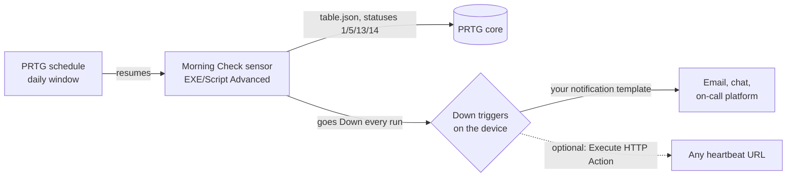

# How it works

One sensor, one schedule, and one or two triggers on the device. PRTG does
the rest with the Down state as it would for any sensor.



## What PRTG is doing

Four standard PRTG features, each used for one job:

| Feature | Its usual job | Its job here |
|---|---|---|
| **Sensor state** | says whether the monitored thing is healthy | the script sets Down on every run, so the sensor's Down is the signal "the report is ready" and its message is the report |
| **Schedule** | pauses monitoring during maintenance | pauses the sensor all day except the window, so the resume is the daily start |
| **State trigger** | notifies when a sensor changes state | fires on the resume into Down, once a day, with zero latency on this device |
| **Notification template** | delivers a sensor's alert somewhere | trigger 1 delivers the report; trigger 2 makes an HTTP call to a heartbeat URL |

The sensor is a normal EXE/Script Advanced sensor and the schedule, trigger
and notification are ordinary objects on ordinary settings pages. The only
convention is that this sensor's Down is expected: it lives in its own group
so the colour stays out of the rest of the tree.

## The daily run

1. **Window start** (06:00 by default) the schedule resumes the sensor and
   the first scan follows a few minutes later ([PRTG-SETUP.md](PRTG-SETUP.md)
   step 2 has the timing).
2. The script asks the core for every sensor in Unknown (1), Down (5),
   Down (Acknowledged) (13) or Down (Partial) (14), drops its own object id
   and anything matching the exclusion substrings, and builds the message:

   ```
   5 to check: 1 unknown, 1 down, 2 acknowledged, 1 partial | DOWN: Local Probe > [ACME] Store 12 > Store 12 Router > Ping | ...
   ```
   or, on a clean morning:
   ```
   ALL CLEAR: 0 unknown, 0 down, 0 acknowledged, 0 partial
   ```
3. The sensor returns **Down** either way. Coming out of Paused, that is a
   state change, so the device's Down triggers fire and the message goes out
   through the notification template on the trigger.
4. **Window end** (06:10 by default) the schedule pauses the sensor. PRTG
   sends the trigger's "Down ended" notification, if one is set.

A second trigger can send an HTTP GET to a heartbeat URL. The ping then comes
from PRTG's notification engine, not from the script, so a missing ping means
the schedule did not resume the sensor, the probe did not run the script, the
core is down, or the notification engine is not delivering. Whatever watches
that URL raises the alert.

## The all-clear

The post goes out each morning with or without findings. A clean morning is
an "ALL CLEAR" post, so the reader knows the check ran, and the heartbeat, if
you use one, records the same thing without a reader.

The sensor is red on the PRTG map for the length of the window and stays red
in the tree until it pauses. Its own group keeps that colour out of the
other groups.

## PRTG constraints the design works around

- **One line of 2000 characters.** PRTG rejects a line break inside a
  sensor message (error PE233) and caps the message at 2000 characters. The
  message uses ` | ` as its separator, the header goes first, and the list
  is cut with `+N more` from the acknowledged end, so the Down entries go
  in first. Tighten the exclusions if the tail matters, or read the rest
  in PRTG.
- **A Down sensor lists itself.** The script drops its own object id, which
  is why the parameters carry `-SelfSensorId %sensorid`.
- **Trigger latency is longer than the window.** A Root trigger with a
  latency longer than the window never sees this sensor Down, so the device
  has its own zero-latency trigger and trigger inheritance off.

Dedup, titles and the dead-man switch belong to the platform that receives
the notification; [on-call/README.md](on-call/README.md) covers them.
